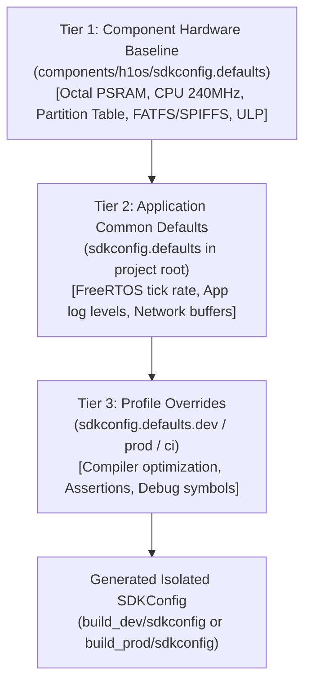

# H1OS Build Profile Reference Gallery

This directory serves as the canonical reference gallery of build configurations and `CMakePresets.json` templates for H1OS instrument applications.

---

## 1. Architectural Philosophy: 3-Tier Configuration Inheritance

H1OS enforces a clear boundary between hardware silicon contracts and application-level features. Configuration values follow a strict three-tier inheritance cascade:



### Tier 1: Hardware Baseline (`components/h1os/sdkconfig.defaults`)
- **Location:** `components/h1os/sdkconfig.defaults`
- **Ownership:** H1OS Core Component.
- **Injected By:** `components/h1os/project_include.cmake` (automatically prepended to `SDKCONFIG_DEFAULTS` during CMake project configuration).
- **Scope:** Invariant physical silicon and board contracts:
  - ESP32-S3-WROOM-1 / PICO-1 Octal PSRAM timing and cache tag allocation.
  - CPU 240 MHz turbo frequency and Dynamic Frequency Scaling (DFS).
  - Custom partition table routing (`partitions.csv`).
  - Storage volume counts (`CONFIG_FATFS_VOLUME_COUNT=1`, `CONFIG_SPIFFS_MAX_PARTITIONS=1`).
  - RTC memory bounds and ULP-RISC-V coprocessor reservations.
  - Zero application knowledge required by downstream projects.

### Tier 2: Application Common Baseline (`sdkconfig.defaults`)
- **Location:** `<project_root>/sdkconfig.defaults`
- **Ownership:** Application developer.
- **Scope:** Application-wide features common to all profiles (e.g. FreeRTOS configuration, Wi-Fi/BLE subsystems, font caches, general logging).

### Tier 3: Profile Overrides (`sdkconfig.defaults.<preset>`)
- **Location:** `<project_root>/sdkconfig.defaults.<preset>`
- **Ownership:** Target-specific deployment constraints.
- **Scope:** Compilation optimizations, assertions, and diagnostic instrumentation:
  - `sdkconfig.defaults.dev`: Development profile (O0 / Og optimization, assertions enabled, debug symbols, compiler sanitizers).
  - `sdkconfig.defaults.prod`: Production profile (Os size optimization, assertions disabled, minimal logging, stripped symbols).
  - `sdkconfig.defaults.ci`: Continuous Integration profile (headless build verification).

---

## 2. Isolated Per-Profile SDKConfig Architecture

In standard ESP-IDF projects, switching between `dev` and `prod` overwrites a single root `sdkconfig` file, causing configuration drift and forcing repetitive clean reconfigures.

H1OS resolves this by specifying isolated configuration targets inside `CMakePresets.json`:

```json
{
  "name": "dev",
  "displayName": "Development Profile",
  "binaryDir": "build_dev",
  "cacheVariables": {
    "IDF_TARGET": "esp32s3",
    "CMAKE_EXPORT_COMPILE_COMMANDS": true,
    "SDKCONFIG": "${sourceDir}/build_dev/sdkconfig",
    "SDKCONFIG_DEFAULTS": "sdkconfig.defaults;sdkconfig.defaults.dev"
  }
}
```

```json
{
  "name": "prod",
  "displayName": "Production Profile",
  "binaryDir": "build_prod",
  "cacheVariables": {
    "IDF_TARGET": "esp32s3",
    "CMAKE_EXPORT_COMPILE_COMMANDS": true,
    "SDKCONFIG": "${sourceDir}/build_prod/sdkconfig",
    "SDKCONFIG_DEFAULTS": "sdkconfig.defaults;sdkconfig.defaults.prod"
  }
}
```

Because `"SDKCONFIG"` points directly into each profile's build directory (`build_dev/sdkconfig`, `build_prod/sdkconfig`), building `dev` and `prod` can occur concurrently or alternately without modifying the project root or clobbering build state.

### Preventing IDE & Extension File Modifications (`CMakeUserPresets.json`)

To prevent the VS Code ESP-IDF extension or local development tools from modifying the version-controlled `CMakePresets.json`, H1OS uses the CMake standard **`CMakeUserPresets.json`** (which is added to `.gitignore`):

1. **`CMakePresets.json`**: Checked into Git. Contains clean, project-wide, vendor-agnostic presets (`dev`, `prod`, `ci`).
2. **`CMakeUserPresets.json`**: Local to the developer's workstation and ignored by Git. Inherits from the base presets and stores local paths, OpenOCD configuration, and IDE vendor settings:

```json
{
  "version": 3,
  "configurePresets": [
    {
      "name": "dev-user",
      "inherits": "dev",
      "vendor": {
        "espressif/vscode-esp-idf": {
          "schemaVersion": 1,
          "settings": [
            {
              "type": "openOCD",
              "value": {
                "debugLevel": 2,
                "configs": ["board/esp32s3-builtin.cfg"],
                "args": []
              }
            }
          ]
        }
      }
    }
  ]
}
```

This guarantees that IDE GUI actions (such as setting device targets or OpenOCD debugging) write exclusively to the gitignored `CMakeUserPresets.json`, leaving `CMakePresets.json` permanently immutable and clean in Git.

---

## 3. Profile Discovery in `h1os.ini`

Applications register profiles in `h1os.ini` to auto-populate the interactive console (`h1os_menu.py`), size auditing (`h1os_size.py`), and release packaging (`h1os_pack.py`):

```ini
[project]
name = MyInstrument
version = 2.4.5
target = esp32s3

[prod]
preset = prod
build_dir = build_prod
audit_log_dir = build_prod

[dev]
preset = dev
build_dir = build_dev
audit_log_dir = build_dev
```

When 2 or more profiles are declared, `h1os_menu.py` automatically presents unified operations (`Build Firmware`, `Reconfigure Build Profile`, `Clean & Full Rebuild`, `Size Audit Diagnostic`, `Package Release Bundle`, `Flash Firmware to Device`) that launch a profile selection sub-menu.

---

## 4. Bootstrapping a New Instrument Application

To create a new H1OS application:
1. Copy `CMakePresets.json` from this gallery into your project root.
2. Copy `sdkconfig.defaults`, `sdkconfig.defaults.dev`, and `sdkconfig.defaults.prod` into your project root.
3. Configure `h1os.ini` using `components/h1os/h1os.ini.template` as a model.
4. Execute `idf.py -B build_dev --preset dev reconfigure` or launch `python components/h1os/tools/menu/h1os_menu.py`.
